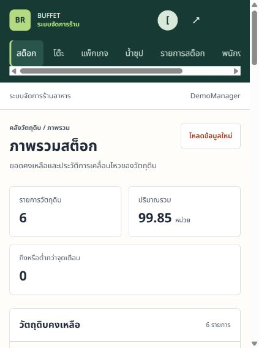

# บัญชีทดลองออนไลน์ — PR #56

ตรวจวันที่ 11 ตุลาคม 2026 บน <https://buffet-restaurant-management.onrender.com/> ตาม [คำขอแก้ไข](https://github.com/PavaritPramual/buffet-restaurant-management-system/pull/56#pullrequestreview-5482634314) รายงานนี้แยกการตรวจบัญชีบนเว็บรุ่นปัจจุบันจากการตรวจ Dashboard หลัง deploy

## การเตรียมบัญชี

ผู้ใช้เข้าสู่ระบบ Manager เดิมให้ และยืนยันให้สร้าง/เผยแพร่บัญชีทดลองสี่ role ก่อนบันทึก การตรวจหน้า Manager → พนักงานพบ 10 บัญชีปัจจุบัน ไม่มีบัญชีที่เก็บออก และมี `Manager` / `supervisor` ใช้งานอยู่ จึงเลือกชื่อ `Demo...` แยกทั้งหมด ไม่เปลี่ยนรหัส/role/active/profile ของบัญชีเดิม

สร้างทีละบัญชีผ่านหน้าเพิ่มพนักงานเดิม โดยใช้ชื่อแสดง `[TEST DATA] Demo ...`, ชื่อ `Demo`, นามสกุลตาม role และอีเมล `@example.test` หลังสร้างมี 14 บัญชี ไม่เพิ่ม enum, auth bypass, migration หรือ startup seeder บนฐานกลาง รหัสของบัญชีทดลองที่ได้รับอนุญาตให้เผยแพร่อยู่ใน [README](../../README.md#บัญชีสำหรับทดลองเว็บ-demo-ออนไลน์)

| Username | User ID | Role | Active / Archived |
|---|---:|---|---|
| DemoManager | 16 | MANAGER | true / null |
| DemoSupervisor | 17 | SUPERVISOR | true / null |
| DemoServiceStaff | 18 | SERVICE_STAFF | true / null |
| DemoKitchenStaff | 19 | KITCHEN_STAFF | true / null |

รายการ ID/role/status ที่อ่านกลับจาก API หลังสร้างอยู่ใน [หลักฐานบัญชีที่สร้าง](../../test/evidence/online-demo-2026-10-11/created-users.json)

## ผลตรวจบนรุ่นออนไลน์ปัจจุบัน ก่อน deploy Dashboard

API ตรวจเสร็จ `2026-10-11T09:06:20Z` (16:06 ICT) รวม **34/34 ผ่าน** ใช้ HTTP session แยกต่อบัญชี ตรวจ username/role ทั้งจาก login response และ `/auth/me` ไม่บันทึก cookie/session ID หรือข้อมูลบัญชีส่วนตัวในหลักฐาน ดู [ผล HTTP ที่ตัดข้อมูลลับออกแล้ว](../../test/evidence/online-demo-2026-10-11/api-results-before-deploy.json)

| บัญชี | Login | Me | Logout | Me หลัง logout | หน้าแรกที่เปิดผ่าน browser จริง |
|---|---:|---:|---:|---:|---|
| DemoManager | 200 | 200 | 204 | 401 | `/admin/stock` — ภาพรวมสต๊อกและเมนูจัดการของ Manager |
| DemoSupervisor | 200 | 200 | 204 | 401 | `/admin/stock` — แสดงเมนูสต๊อกเท่านั้น |
| DemoServiceStaff | 200 | 200 | 204 | 401 | `/staff/tables` — โต๊ะในร้านและเมนูงานเสิร์ฟ |
| DemoKitchenStaff | 200 | 200 | 204 | 401 | `/kitchen` — ออเดอร์ที่รอดำเนินการและเมนูงานครัว |

| GET API | Manager | Supervisor | Service Staff | Kitchen Staff |
|---|---:|---:|---:|---:|
| `/api/v1/stock` | 200 | 200 | 403 | 403 |
| `/api/v1/admin/users` | 200 | 403 | 403 | 403 |
| `/api/v1/orders/incoming` | 403 | 403 | 403 | 200 |
| `/api/v1/orders/ready` | 403 | 403 | 200 | 403 |

Anonymous `/auth/me` ได้ 401; ส่ง `X-User-Role: MANAGER` โดยไม่มี session ไป `/admin/users` ยังได้ 401 สิทธิ์ Manager/Supervisor ไม่ขยายไปครัว/งานเสิร์ฟ การตรวจรอบนี้ไม่เขียนข้อมูลโต๊ะ รอบกิน Order Payment หรือ Stock

ภาพ browser: [Manager](../../test/evidence/online-demo-2026-10-11/manager-home-before-deploy.png), [Supervisor](../../test/evidence/online-demo-2026-10-11/supervisor-home-before-deploy.png), [Service Staff](../../test/evidence/online-demo-2026-10-11/service-home-before-deploy.png), [Kitchen Staff](../../test/evidence/online-demo-2026-10-11/kitchen-home-before-deploy.png) แต่ละบัญชีออกจากระบบแล้วกลับหน้า login

## สิ่งที่ยังต้องตรวจหลัง deploy รุ่น PR #56

### ปวริศช์ตรวจบัญชีซ้ำและปรับ README ใน PR เดิม

ตรวจวันที่ 11 ตุลาคม 2026 ด้วย HTTP session แยกทั้งสี่บัญชี login/me200 และ username/role ตรง, logout204, meหลังlogout401; GET stock/users/incoming/ready ได้ 200/403 ตามตารางเดิมทุกบัญชี ส่วน Dashboard404ทุกบัญชีตรงกับรุ่นที่ยังไม่ deploy ผลที่ตัด cookie/password ออกอยู่ใน [account recheck](../../test/evidence/online-demo-2026-10-11/pavarit-account-recheck.json)

README ใช้ลิงก์เข้า `/admin`, `/staff/tables` และ `/kitchen` โดยตรง พร้อมวิธีทดลอง Customer และการแยก browser session ลิงก์ `/admin` คงใช้ได้ทั้งก่อนและหลัง deploy Dashboard การตรวจนี้ไม่เขียนข้อมูลร้านหรือแก้บัญชี และไม่รับรอง browser visual/Core Flow ใหม่จากผล HTTP

บัญชีออนไลน์เป็นข้อที่แก้แล้ว ส่วนรายการด้านล่างเป็น gate รับรอง Dashboard หลังรวมและ deploy รุ่นใหม่ ไม่ต้องสร้าง PR บัญชีแยกเพิ่ม

**ยังไม่รับรอง Dashboard บน public deployment**: ณ `2026-10-11T09:08:04Z` การเรียก `/api/v1/dashboard` ด้วย DemoManager ได้ **404** และ browser เปิดหน้าสต๊อกแบบเดิม หน้า Render ยังอยู่ที่ login จึง **ยังยืนยัน deployed commit ไม่ได้** ไม่ใช้ SHA ของ branch หรือผล CI มาแทน SHA ที่ Render ขึ้น Live การตรวจบัญชีบนรุ่นปัจจุบันผ่านแล้ว แยกจาก gate ตรวจ Dashboard หลัง merge/deploy

โค้ด Dashboard ที่ผ่าน CI ก่อนการแก้เอกสารรอบนี้คือ `c8a2cc2adfcb3a0bbc8b02d2f571ee95ee1a1d5e` ([CI run #128](https://github.com/PavaritPramual/buffet-restaurant-management-system/actions/runs/38125092490)) ไม่ใช่การรับรองว่า commit นี้ deploy แล้ว

เมื่อเจ้าของ service เข้าสู่ Render/ปล่อยรุ่นที่ต้องการแล้ว ต้องบันทึก commit จริง, deploy ID/เวลาและสถานะ Live จาก service เดิม จากนั้น:

1. รัน login → me → logout → me หลัง logout และตรวจสิทธิ์ตามตารางอีกครั้งบน Render รุ่นใหม่
2. ตรวจ Dashboard API: Manager/Supervisor ได้ 200 พร้อม `Cache-Control: no-store`; Service Staff/Kitchen Staff ได้ 403 และ anonymous ได้ 401
3. เปิด browser ให้ Manager/Supervisor เข้า `/admin/dashboard` เป็นหน้าแรก ตรวจเมนูตามสิทธิ์เดิม ส่วน Staff/Kitchen เข้าหน้าเดิม แล้วอัปเดตตาราง README ให้ตรงรุ่นที่ตรวจ
4. แนบผลพร้อม deployed SHA จริงเพื่อรับรอง Dashboard หลัง deploy ไม่ถือว่าผล 34 จุดข้างต้นเป็นหลักฐาน Dashboard หลัง deploy

Customer ไม่ต้องมีบัญชี ให้ Service Staff เปิดรอบกินแล้วใช้ QR ตามขั้นตอนใน README การตรวจบัญชีครั้งนี้ไม่ได้เปิดรอบ/แลก QR หรือทดสอบ Payment/close/Stock ซ้ำ ผล core flow ก่อนหน้าและผล local/CI ของ Dashboard มีขอบเขตแยกจากรายงานนี้
