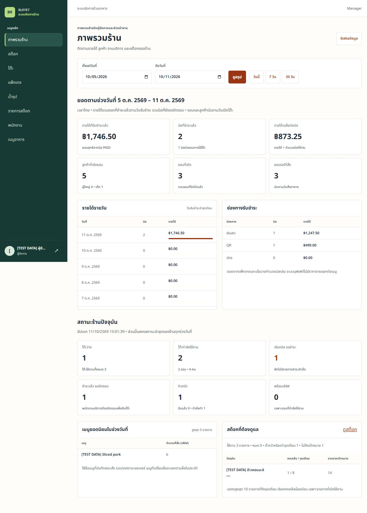

# Management Dashboard — local verification, 11 October 2026

Pre-PR local checks are based on `origin/develop ffb654b` on `sirapat_673380293-3_01`. No deployment or shared-database provisioning was performed. Existing untracked slide drafts were preserved and excluded from this change.

## Automated checks

| Check | Result / scope |
|---|---|
| Final backend review | `verify` passed: 441 discovered; 427 passed, 14 skipped, 0 failures/errors. All environment-driven PostgreSQL suites were enabled. Skips are four existing Docker-only suites (master-data archive migration and stock/profile/security/archive), not Dashboard scenarios. |
| Dashboard scenarios | The same 5 cases passed on H2 and disposable PostgreSQL **18**; credentials/seeding rerun test also passed (11/11 focused). Final review used a fresh cluster on loopback port 55442 and the actual CI provisioning SQL, including `buffet_test_dashboard_ci` with the required database marker. |
| Full frontend suite | 193/193 tests across 21 files passed. Includes Manager/Supervisor default dashboard, legacy staff homes, session expiry, retry/empty/date validation and stale response suppression. |
| Frontend build/lint | Build passed; lint 0 errors and 5 existing warnings in StockPage, UsersPage, KitchenBoardPage and StaffServingPage. No new Dashboard warning. |
| Demo provisioning | Manager created the other three roles through existing `/admin/users`; all four documented passwords authenticated. Subsequent runs reused accounts without duplication. Remote URL and non-manager attempts were rejected. |
| Legacy browser runners | Updated demo login names/passwords and Manager/Supervisor home expectations; syntax checks passed. The complete older browser runner suites were not rerun. |
| Public browser runtime guards | 6/6 Node tests passed. |

Final backend command: `mvnw.cmd -o --batch-mode --no-transfer-progress verify` with `ALLOW_DESTRUCTIVE_DB_TESTS=true` and all four CI PostgreSQL opt-ins (`MENU_TEST`, `DINING_TEST`, `PAYMENT_TEST`, `DASHBOARD_TEST`) pointing to the freshly provisioned local cluster. The payment suite used the limited `buffet_backend_test` role from the CI SQL. H2/default test resources were used for the rest of the suite. Frontend command: `npm test -- --maxWorkers=1`; TEMP/TMP pointed to a workspace temp directory to avoid the Windows sandbox temporary-file issue.

CI now provisions a separate marked Dashboard database and enables its PostgreSQL scenarios on every PR. Actual GitHub Actions results must be checked on the PR; the local results here are not a substitute for CI.

## Real local API and browser checks

Started the demo profile with H2, session authorization, database Ordering/Billing/Payment providers and a local frontend. Created package/menu/table data using Manager; ServiceStaff opened 3 rounds, Customer redeemed QR and ordered, KitchenStaff advanced orders, ServiceStaff served/paid/closed, and Supervisor adjusted stock. No external payment gateway or real money was involved.

- 2 PAID bills: CASH 1,247.50 + QR 499.00 = **1,746.50 THB**; average **873.25 THB**. Closed and still-active paid rounds are each counted once.
- 3 opened rounds, 4 adults + 1 child, 3 orders and 6 servings of the sample menu.
- Current state: 1 available table, 2 occupied, 1 unpaid bill request, 1 paid round awaiting close, 1 preparing order, and 1 low-stock item with 14 units missing against target.
- Real browser: Manager dashboard at 1280×900; Supervisor at 360×800. No page horizontal overflow. Supervisor navigation contains only dashboard/stock; direct `/admin/users` redirects to stock. Login/logout and invalidated login after backend restart were checked.
- [summary.json](summary.json) is the actual sanitized API response from local demo. [api-smoke-result.json](api-smoke-result.json) contains the checked totals.

[Supervisor mobile screenshot](supervisor-mobile.png)

These results do not certify the public deployment, shared database, CI, or release acceptance. Demo accounts in README are for visitors running a local copy and are not claimed to exist on Render.
